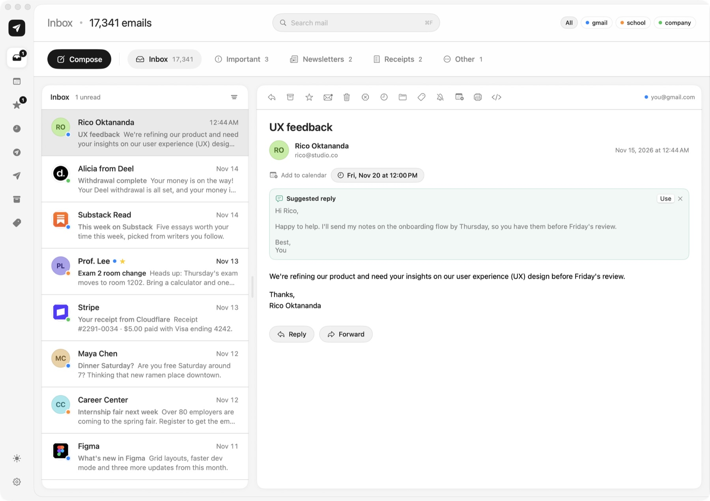
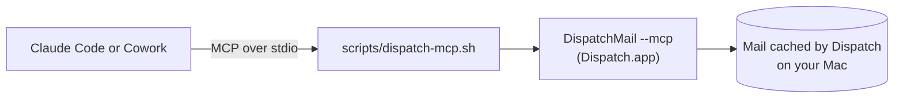

<div align="center">


# Dispatch Mail for Claude

Read, search and triage your email from Claude, using [Dispatch](https://newitools.app/dispatch/),<br>
a free, open source Mac mail app that merges Gmail and iCloud accounts.

[](#install)
[](.claude-plugin/plugin.json)
[](https://newitools.app/dispatch/)
[](LICENSE)

[**Get Dispatch**](https://newitools.app/dispatch/) · [Privacy policy](https://newitools.app/dispatch/privacy/)

<br>

<picture>
  <source media="(prefers-color-scheme: dark)" srcset="docs/shot-dark.jpg">
  
</picture>

</div>

## Install

In Claude Code:

```
/plugin install dispatch-mail --marketplace andrewneuwirth/dispatch-claude-plugin
```

[Download Dispatch](https://newitools.app/dispatch/) (free, notarized by Apple) and add your accounts first. The plugin
needs Dispatch in /Applications.

## Use it

Ask Claude things like "what needs a reply from me?", "find the receipt from last week's flight", or "draft a reply to
Maya saying Friday works".

| Find | Read | Act when asked | Reply |
| --- | --- | --- | --- |
| `search_mail` (Gmail search syntax works for Gmail accounts: `from:`, `subject:`, `newer_than:7d`, `has:attachment`) or `list_messages` for the inbox, starred, sent or all mail. | `read_message` opens a message before Claude quotes or summarizes it. | `archive`, `star` and `mark_read`, and Claude says what it changed. | `create_draft` saves a threaded reply in Drafts from the right account. |

Sending stays off unless you turn on **Settings › MCP › Let AI tools send mail** in Dispatch.

The tools run on your Mac, so this plugin works in Claude Code and in Cowork sessions on your computer.

## How it connects



| File | What it does |
| --- | --- |
| `.mcp.json` | Registers the `dispatch` MCP server for Claude |
| `scripts/dispatch-mcp.sh` | Starts `DispatchMail --mcp`, or explains how to get Dispatch if it isn't installed |
| `skills/dispatch-mail/SKILL.md` | Tells Claude when and how to use the mail tools |

## Data and privacy

The plugin starts Dispatch's local MCP server (`DispatchMail --mcp`) over standard input and output. It reads the mail
Dispatch has cached on your Mac and passes what Claude asks for to Claude. Nothing goes to the makers of Dispatch, and
the plugin stores nothing itself. Privacy policy: https://newitools.app/dispatch/privacy/. Questions: hello@newitools.app

## License

[MIT](LICENSE)
